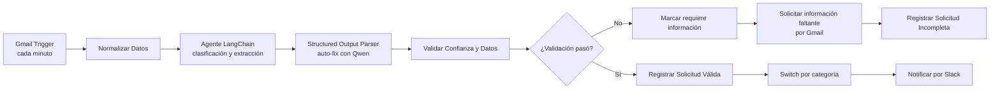

# Arquitectura de la automation

## Diagrama lógico



## Capa de IA

- Modelo principal: OpenAI GPT-5-mini.
- Fallback: Gemini Flash Lite 3.1.
- Salida: JSON validado por schema.
- Auto-fix: Qwen 3.6 conectado al parser.
- Instrucción: extraer únicamente información presente, indicar faltantes y no ejecutar acciones sensibles.

## Criterio de validación

Una solicitud es válida cuando:

```text
confidence >= 0.75
category válida
priority válida
requester_email presente
missing_information está vacío
```

Si falla, se registra la razón como `Confianza baja`, `Información faltante` o `Datos inválidos`.

## Ramas

### Incompleta

Marca el pedido, envía un email profesional solicitando los datos faltantes y lo registra en `Solicitudes_Incompletas`.

### Válida

Registra el pedido en `Solicitudes_Completas`, lo deriva por categoría y notifica al canal Slack de prueba. Las ocho salidas son People, Finanzas, Compras, Accesos, Soporte, Proyectos, Administración y Revisión Manual.

## Limitación actual

La variable `requires_human_approval` se calcula y se expone en Sheets/Slack, pero todavía no existe una pausa real ni un callback de aprobación. Para convertirlo en control operativo habría que agregar un mecanismo de aprobación, persistir el estado y reanudar solo después de una decisión autorizada.
